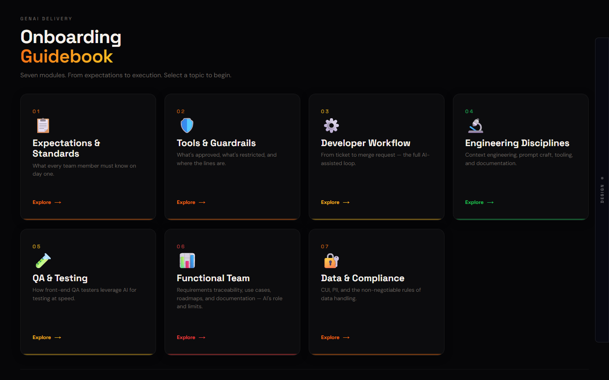

# Architecture Deck System

[](https://github.com/tafreeman/architecture-deck-system/actions/workflows/ci.yml)
[](LICENSE)
[](https://tafreeman.github.io/architecture-deck-system/demo/)

React 19 + Vite 6 presentation platform with 6 registered content decks, 39 registered layouts, 16 themes, and 4 style modes. Includes Storybook for visual testing and an export pipeline for HTML, images, and PDF.

## Preview



*Onboarding Guidebook deck — midnight-teal theme, info-cards layout. Open the DESIGN panel to switch decks, themes, and style modes at runtime.*

## Live Demo

[Open the interactive deck viewer](https://tafreeman.github.io/architecture-deck-system/demo/) or visit the [project overview](https://tafreeman.github.io/architecture-deck-system/). Use the DESIGN panel in the viewer to switch decks, themes and style modes.

## Quick Start

Use Node.js 24 (the version tested in CI).

```bash
npm ci
npm run dev          # Dev server on :5173
npm run typecheck    # TypeScript check
npm run build        # Vite production build
npm run storybook    # Storybook on :6006
```

For image/PDF export, install Playwright’s Chromium browser first:

```bash
npx playwright install chromium
npm run export:all
```

## Content Decks

| Deck Key | Label | Theme |
|----------|-------|-------|
| `current` | Current (Advocacy) | midnight-teal |
| `genai` | AI Fluency Guidebook | (see structure.js) |
| `engineering` | Engineering | (see structure.js) |
| `onboarding` | Onboarding | (see structure.js) |
| `verge-pop` | Verge Pop | verge-orange |
| `studio` | Studio Handbook | studio-craft |

Each deck consists of `structure.js` (layout skeleton with colors) + `content.json` (text data). Runtime content swapping is supported — any content pack can be applied to any structure via the ControlPanel "DECK" picker.

## Storybook

Autodocs enabled. Global `ThemeContext` + `ChromeContext` decorator with theme/chrome toolbar selectors in `.storybook/preview.jsx`.

## Developer Guides

- **[docs/ARCHITECTURE.md](docs/ARCHITECTURE.md)** — layer overview, data flow, the full layout-family registry table, and the 16-theme × 4-style-mode matrix.
- **[docs/DOCUMENTATION-REVIEW.md](docs/DOCUMENTATION-REVIEW.md)** — how to add a new layout family, theme, or content deck; key interface quick reference; known issues and technical debt.

## Gotchas

- Rollup does NOT auto-resolve `.js` → `.ts` — update import paths when renaming
- Tokens are `.ts` with exported interfaces — import with `.ts` extension
- All components are `.tsx`, stories remain `.jsx`
- Unit tests run on Vitest (`npm test`); Storybook (`npm run storybook`) is for visual/interaction review
- `@storybook/addon-actions` not installed — use `console.log` shim instead
- `stat-cards-manifest` is a registered layout ID (auto-routed by LayoutRenderer when slide has manifest fields) — do not register a new layout with this ID
- Layout components receive `topic` prop (not `slide`) — this is the LayoutRenderer's forwarding alias

## Built with AI assistance

This presentation platform was built with AI-assisted development (LLM coding assistants) under human review. All sample deck content uses generic, illustrative examples — no client, employer, or engagement-identifying material.

## License

MIT — see [LICENSE](LICENSE).
